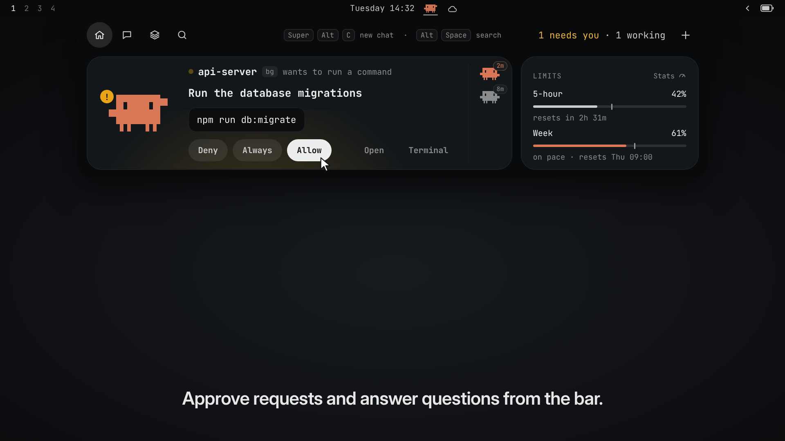

# Clawdius

Clawdius is a tiny pixel crab beside the bar clock. He types while any Claude
Code session is busy and waves when one needs you: orange while Claude is
doing something, gray when nothing is. Hover the middle of the bar (the
clock, the crab) and an island drops from the bar; click the crab to pin it.
When a turn that ran ≥ 8s finishes, or a session gets stuck waiting on you,
the island says so (no desktop notification): closed, it opens just far enough for the note; open, the note
sits up top above the nav. Not when that session's terminal is the window
you're looking at. Clicking the note focuses its terminal (a background
session opens up close in the island).

A community plugin for [Omarchy](https://omarchy.org). Not made by or
affiliated with Anthropic; Claude and Clawd are theirs.

## See it in action

[](brag.mp4)

A 24-second tour: approving a request, answering Claude's question, a
finished turn, a session live, search and a new chat. Click the picture to
watch it.

## Install

```bash
omarchy plugin add https://github.com/cybercivizen/omarchy-clawdius.git --enable
```

Pick `center` when it asks where on the bar: the crab sits beside the clock.

### What it needs

- Omarchy with the Quickshell bar (Quattro). Everything else the crab uses
  (Python, `tmux`, `git`, `wl-copy`) comes with Omarchy.
- [Claude Code](https://claude.com/claude-code), the `claude` command,
  signed in. Omarchy doesn't install it for you. Without it the crab just
  sits there with nothing to show.
- Optional: `gh` for the GitHub button on a session, `code` for the VS Code
  button.

It works with any clock, or none: hovering the middle of the bar opens the
island.

The plugin installs nothing and leaves your settings alone. The only thing it
makes outside its own folder is `~/chat`, the first time you start a Chat.

### Set it up

- **Keyboard.** Omarchy plugins can't add key bindings, so add these to
  `~/.config/hypr/bindings.lua`:

  ```lua
  o.bind("SUPER + ALT + C", "Claude island", "omarchy-shell -q clawdius summon")
  o.bind("ALT + SPACE", "Claude island search", "omarchy-shell -q clawdius search")
  ```

  Super+Alt+C pulls the island down with the keyboard on it, and Alt+Space
  opens it on the search.
- **Approvals from the island** (optional). Run
  `python3 ~/.config/omarchy/plugins/cybercivizen.clawdius/approvals.py install`.
  It adds a `PermissionRequest` hook to `~/.claude/settings.json`, after
  saving a dated backup. Without it, the island still tells you when a
  session needs you; you answer in the terminal. See [Approvals](#approvals).
- **Chat and Code.** Nothing to do. **Code** starts Claude Code in `~/Work`,
  the folder Omarchy sets up for your projects, in auto mode. **Chat** starts
  a talk-only session in `~/chat`: Claude can't run commands or edit files
  there, and answers the way it does on claude.ai (`chat.md`). The
  `--chat` at the end of the *Chat command* setting does that, so keep it if
  you change the command. Claude Code asks once whether to trust each
  folder; the island shows that question for you.
- **Frosted glass** (optional). The island is see-through so Hyprland can
  blur what's behind it. Turn on `blur_popups` for the `omarchy-bar` layer to
  get the effect.

### Remove

```bash
python3 ~/.config/omarchy/plugins/cybercivizen.clawdius/approvals.py uninstall  # only if you installed the hook
omarchy plugin remove cybercivizen.clawdius
```

Take out the two key bindings too, if you added them. The crab keeps a
little state in `clawdius/` folders under `$XDG_STATE_HOME`
(`~/.local/state`), `$XDG_CACHE_HOME` (`~/.cache`) and `$XDG_RUNTIME_DIR`.
Delete those to clear it.

### Moods

The crab shows the most pressing thing going on, in this order:

| Mood | When | Crab | Card |
|---|---|---|---|
| waiting | a session is blocked on you (permission prompt, sandbox request, input needed…) | waves a claw, `!` badge | "!" bits, row lit |
| done | a ≥ 8s turn just finished (3.5s) | claws up, hopping | sparkles |
| typing | busy, running tools | taps the keys | code bits |
| thinking | busy, nothing written for 8s since the last tool result | claw at chin, eyes up | "?" |
| failed | a turn ended `failed:` (15s, when nothing is busy) | claws down, eyes shut | "…" |
| sleep | idle between midnight and 6am | eyes shut | z's |

It sweats (a drop runs down its side) once the 5-hour limit is 90% spent.

On a machine that isn't the desktop (`~/dotfiles/.machine` is anything but `desktop`, or missing) the crab on the bar holds still: no typing, bobbing, blinking or sweat drop, only the orange/gray color change. Each step of those redraws the whole bar, which a laptop's integrated GPU feels for as long as a session works. The crabs inside the island still move.

### The island

Near-black, hung straight off the bar,
with an icon nav: **Home**, **Chat** (a new chat), **Sessions**, **Search**
(the icon stretches into a search bar), the status ("1 needs you · 2
working"), a gear for **Settings**, and **+** for a new session from any view. Opened by hovering,
the nav also shows the two shortcuts (hidden when the status leaves no room).
The island opens from the empty bar within the middle 560 px
(`hoverZoneWidth`), not only the clock and crab: a passive `HoverHandler` on
the bar window. Other widgets in that stretch (the tray arrows, a media title)
are skipped, so they keep their own hover and clicks and never open it.

Every view is 948 px wide, however it was opened (only a notification peek
is narrower). The popup window stays at the widest and tallest size and
only the drawn island morphs between sizes: resizing the Wayland popup showed one frame of the old
buffer squashed into the new size.

- **Home** shows one *moment* at a time, the most pressing first: a
  permission prompt (Deny / Always / Allow, or Terminal; a line under the
  buttons says what Always saves and where), one of Claude's
  questions (its options to click; several questions or a multi-pick send
  together) or a plan to approve (the plan, Keep planning / Approve plan), a
  session blocked on you some other way, a turn that just finished or failed
  (until OK, or 30s), one stopped by the **usage limit** (purple: the crab
  asleep with z's, when the spent limit resets and a bar filling toward it;
  **Ring at …** sets an alarm for the reset, like the corner card's),
  the session being watched, or nothing running. Each has a big crab with a
  status badge (amber `!`, green ✓, red ✗, purple z, orange dots while working) and a
  faint glow in the state's color. The watched session shows its last three
  steps: Claude's plan when it wrote one (`tasks`), else its last tool calls
  from the transcript (`actions`: ✓ done, spinner running, ✗ failed). It is
  sticky, so two busy sessions don't trade places every second. While a
  tool call is out (one running past the feed's 1 s poll) it is the last row,
  lit up with a clock and its command or path under it. Between calls the
  model is writing, and nothing of that reaches the transcript (thinking
  blocks are saved empty), so there's no row for it: the newest step (the
  plan's current one) carries the spinner and the elapsed time (with no step
  yet, the row is just those). Claude's latest words, mostly a recap of the
  step before, are left to the detail view. Done, working and waiting share
  one frame: the session's line fixed at the top, the buttons (or the
  tokens / context footer) at the bottom, so nothing climbs as steps arrive.
  A finished turn's text comes through up to 600 characters; in the dense
  look it is body-size and takes the lines the frame has before the ellipsis.
  With nothing running: **New chat**, into the chat view. (Earlier sessions
  are under Sessions → Recent.)
  The three icons at the card's top left pick what it is (remembered):
  **Agents** (all of the above), **Today**, and **Anti-rot** (today's
  challenge, see below). Anything that needs you (a prompt, a question, a
  failed turn, a limit) shows Agents until it's dealt with, then
  the pick comes back.
  While anything is working and another mode is up, the Agents icon wears a
  small pulsing orange dot, or a steady green one once a turn has finished (a
  finish doesn't take the card over; the other things above do).
  **Today** is the calendar and the weather that used to be bar widgets: a
  month grid with ISO week numbers (‹ ›, the scroll wheel, or a click on the
  month to come back to this one), and beside it the weather now and for the
  next two days. The weather is wttr.in's, for the place in Omarchy's weather
  setting (else the IP's), fetched when the island opens and at most every 30
  minutes into `~/.local/state/clawdius/weather.json`. A click on the bar's
  clock opens the island on Today.
  Other running sessions sit on a **rail** of small crabs on the right, each
  with a bubble on its corner saying how long ago it last moved (since its
  turn started while it works or waits, since it went idle otherwise).
  Hovering one peeks at it (state, folder, current step, Deny / Allow if it's
  waiting); a click pins it to the card, a double-click opens its terminal.
  Its tooltip has a ☆/★ pin button: a pinned session stays on the rail
  (starred crab, first). The same ☆ is on Sessions → Live and Recent rows
  (shown on hover, filled when pinned, fixed at the row's right edge), and
  Sessions → **Pinned** lists them all: running ones, then the rest. Stored as
  `starredIds` in `prefs.json` (called "starred" in code; `pin` already means
  card focus).
  On the working and idle moments a switchable **corner card** sits beside it
  (the three icons at its top right; the choice is remembered):
  - **Limits**: the 5-hour window and the week, with a pace tick; clicking it
    opens **Stats**.
  - **Timer**: a **Timer** (presets or − / +), or an **Alarm** (a clock
    time, 15-minute steps, rings at the next one).
    Running ones list with a draining bar and × to cancel. When one is due,
    the island peeks open with a toast and a chime (setting **Timer sound**).
    They survive a shell restart (`~/.local/state/clawdius/timers.json`); one
    that came due while the shell was down rings on start, marked "Was due".
  - **Move** (the sitter icon): two nudges on one card, **Sit up** (a playful
    sit-up-straight, default every 30 minutes) and **Walk** (stand up and walk,
    default every 60), each with its own Start / Off, countdown and filling
    bar. How often each rings is in **Settings → Move** (sit up 20 to 60,
    walk 30 to 90 minutes). The crab sits tall, slumps in the last two
    minutes, and stretches in a teal toast (↑ for sit up, → for walk) with a
    line to follow. Click the crab to ring the nearest one and try it.
    It's idle-aware: after 2 minutes without input (a playing video counts
    as there) the counts pause and the crab dozes; back after a short break
    they carry on, after 5 minutes or more they start over ("Fresh start
    after your break."). Every mode of the card fits one fixed slot, so
    switching tabs never moves the island.

  Only the first crab (the leader on a multi-monitor bar) rings, so nothing
  goes off twice.
- **Sessions**: **Live** (every running session: small crab, name, `bg` tag,
  folder, then its state on the right; waiting rows amber), **Recent** (every
  conversation that isn't running, newest 8 first then 25 at a time, with
  the cache hint; the old Resume + History) and **Folders** (the 20 folders
  Claude worked in most recently, not the Chat / Code ones nor scratch dirs;
  click one to list its sessions, **+ New session** on hover starts Code
  there).
  Background sessions that never got a prompt are hidden and stopped
  (`live.py reap`) once nothing is attached to them.
- **Detail**: clicking a background session opens it up close. On the left:
  a back arrow beside its crab, its name and folder (where it's working now, so it follows a
  switch into a worktree), its git branch and, for a linked worktree, which
  repository it belongs to, **+ New session here** (Code in that same folder,
  so the same worktree and branch, in the card), then its steps (ACTIONS, or PLAN; an idle
  session keeps its last turn's, ■ for one cut off), and at the foot how
  full its **context** is (against Claude Code's auto-compact window: the
  `autoCompactWindow` setting, per model under `modelSettings`, else 200k),
  and Open in terminal. On the right: chips for mode and folder
  (eliding its middle when long), the terminal live in a dark well at its
  full height from the start (Chat / Code open this view at once, saying
  "Starting Claude…" until the session is up), a rounded composer with a send button (amber while
  Claude's asking and keys go straight to the terminal; its text selects
  with the mouse or Shift+arrows, Ctrl+C copies), and key hints (interrupt
  and ⇧Tab clickable; Esc closes the island, so Ctrl+C on an empty prompt
  interrupts) with the model and effort (the latest turn's, from the
  transcript) on the right. The wheel scrolls it by lines (sent to Claude
  as mouse-wheel steps: a touchpad one a line height swiped, a mouse wheel
  three a notch). Scrolled back, the screen holds its height and a
  floating **Jump to bottom** stands in for Claude's own label. Up / Down
  in the composer go through the prompts given in that folder (Claude's
  `~/.claude/history.jsonl`, as its own Up does; `live.py history`), never
  opening Claude's prompt box. Past six lines the message scrolls inside
  the composer, and the terminal gives up rows as it grows, so the card
  stays the same height. Text that turns up in Claude's own box (a prompt
  given back after an interrupt) moves over to the composer.
- **Closing**: opened by hovering, the island goes when the pointer leaves,
  whatever you clicked inside it. Pinned (the crab clicked), it stays until
  you click outside it. While it shows a live terminal, or there's a chat
  message or search half typed, it stays put, and
  closes when the keyboard moves to another window (a click on it, or
  Hyprland's follow-mouse focusing the window under the pointer). It can't
  use Hyprland's focus grab there: the terminal's key window taking the
  keyboard clears the grab, so every click in the terminal closed it.
  The working moment on Home shows the context percentage too.
- **Chat** (the nav's chat icon, Home's New chat, or **Super+Alt+C**): a
  composer with Clawd peeking up from the island's bottom-left edge. In Code, the
  permission mode (auto, plan, accept edits, ask) sits beside the folder; a click
  or ⇧Tab cycles to the next one, as in the CLI. It's kept in prefs.json; picking Opus Plan sets it to plan. Chat or
  Code, whichever you used last (`~/.local/state/clawdius/prefs.json`;
  Tab or a click switches, ⇧Tab never does): Enter starts that session with the message as
  its first prompt (`claude --bg -- '<message>'`) and goes straight to its
  live view; Shift+Enter is a new line, Esc clears it (or closes the island
  when empty). The text behaves like an input: an I-beam over it, click to
  place the caret, drag or double-click to select, Ctrl+C / Ctrl+V.
  Beside Send, the **model** and **effort** chips and the **paperclip** each
  open a small menu, the same as the live view's (`PickMenu.qml`) but
  dropping down, as the composer sits just under the bar. It hangs past the
  island's bottom on the card's float layer (`FrostCard.floatLayer`, added to
  its input mask and cut out of the key window's cover) instead of stretching
  the island; a click elsewhere closes it. Model and effort go on the
  command line (`--model`, `--effort`) and are kept in prefs.json; the
  paperclip's Files… / Folder… land in the text as `@path`, relative to the
  folder the session will start in. In Code, the folder by the toggle opens
  one too: the Code folder, the last folder Claude worked in, or Open folder…
  (zenity); that choice lasts until the shell restarts.
  **Ctrl+V** with an image on the clipboard saves it under
  `$XDG_RUNTIME_DIR/clawdius/paste/` (`live.py grab`) and shows it as a
  thumbnail over the composer (× or Backspace on an empty prompt takes it
  off); Enter sends it with the message as an `@path`, which Claude attaches
  as an image, and the conversation leaves the path out of your bubble.
  **Opus Plan** stands out in both views' model menus: its row sits on a
  crab-to-purple sweep (`Shimmer.qml`) that drifts in steps while the menu is
  open. On a model chip it shows still and drifts only while pointed at or
  open. Effort levels run cool to hot (`Colors.effort`: teal, green, amber,
  orange, red), as text in the menu and on the effort chip. The
  menus' titles are small spaced-out caps over a hairline, like the island's
  other section labels, so they don't read as a choice.
- **Search** (the nav's search icon, **Alt+Space**, or just start typing on
  Home; Esc there closes the island): with nothing typed,
  a row of apps you've used lately (launches from here, and every window
  that comes to the front, counted in `~/.local/state/clawdius/apps.json`;
  then what's open, then a browser, terminal, file manager and editor).
  Past a divider, the default browser's five most recent tabs as chips, in
  two rows filled a column at a time; what doesn't fit fades out at the
  edge, and › (or the wheel) pages a column on, ‹ back (`tabs.py`: Firefox and its forks' open tabs from the
  session store, newest first; Chromium-likes' last visited pages from
  History; favicons cached in `~/.cache/clawdius/favicons`). A click
  opens the page in the browser again. The bar has no placeholder: the
  line under the apps says what to type. Typing lists the installed apps that match (↑↓ / Tab to pick, Enter or a
  click opens it with `uwsm-app -- gtk-launch`). A sum (`12*(3+4)`,
  `2^10`, `sqrt(2)`, `10/3`: `+ - * / % ^`, brackets, `pi`, `e`, `sqrt abs
  round floor ceil ln log sin cos tan`; `Calc.js`, nothing is eval'd) is
  worked out in a row above the apps, picked first: Enter copies the result
  (`wl-copy`). When no app matches, a Google row takes their place: Enter
  searches Google for what's typed. `/` then a space turns into
  a **Terminal** chip: Enter runs the text in a new terminal
  (`omarchy-launch-terminal bash -ic '<cmd>; exec bash'`). `/g` then a space
  turns into a **Google** chip: Enter opens the search in the default
  browser. Backspace at the start of the text takes the chip back to `/` or
  `/g`, the caret right after it. Esc clears, then drops the chip, then
  closes.
- **Super+Alt+C** / **Alt+Space** (`summon` / `search`, bound in
  `~/.config/hypr/bindings.lua`) pull the island down on the focused monitor
  on that view with the keyboard on it; again closes it. Summoned, typing on
  the other views opens the chatbox over them. The key window then covers
  the screen, see-through, with the bar and the island cut out of its input
  (as Omarchy's KeyboardPanel does): going OnDemand would otherwise hand the
  keyboard to the window under the pointer, and a click outside lands on it
  and closes the island.
- **+** opens Code (`~/Work`, auto mode) or Chat (`~/chat`, talk only) in the
  live view, Web in the browser, or Code in one of the three most recent
  folders (All folders… goes to Sessions → Folders). **Open folder…** picks
  any folder with a file chooser (zenity, starting in `~/Work`); **New
  folder…** asks for a name and makes it in `~/Work` (or wherever a full or
  `~/` path says), then starts Code there. **Clone repo…** asks for a
  GitHub `owner/repo` (or any git URL), clones it into `~/Work` and starts
  Code in it; a private one asks to log in to GitHub first (`gh auth login`
  in a terminal), then clones. A new folder under `~/Work`
  inherits its trust, so it opens in the card. Claude Code won't start
  background sessions in a folder whose trust isn't saved, so the card asks
  its trust question itself ("Do you trust the files in this folder?"): Yes
  saves it as accepting Claude's dialog would (`live.py trust`, which sets
  `projects[dir].hasTrustDialogAccepted` in `~/.claude.json` under Claude's
  lock) and the session starts in the card; Terminal opens it in a terminal
  window, where Claude asks. Claude never saves trust for the home folder,
  so that one always opens in a terminal (plain interactive `claude`).
- **Stats** — Claude usage, replacing the old `cybercivizen.agents` bar icon:
  plan, 5-hour and weekly limits (orange when ahead of the pace tick, red at
  90%), today's tokens / prompts / sessions, tokens per model, last 7 days.
- **Settings** (the gear): settings that live in the island rather than in
  `shell.json`, one section per feature, each folding on a click (`Settings.qml`).
  **Island** has the theme (Soft, Compact, Dense; see Themes) and one switch, *Terminals outside the island*: on, opening a
  session (or starting one) opens a real terminal window instead of the island's
  conversation and live terminal, and the cards show a single **Open** button
  rather than Open plus Open terminal; the sessions, folders, approvals and usage
  stay. **Anti-rot** (folded to start with):
  challenges a day (1–3), each language's on/off switch, its level (− / +, 1–10), and its
  state: ready, not set up (**Set up**), or the toolchain it still needs,
  with the install command. Below them, the **editor** challenges open in
  (Omarchy's default, Neovim, Helix, Nano, VS Code or Zed).

#### Anti-rot

Small exercises, written by hand, to keep in practice when Claude writes
most of the code. `antirot.py` takes them from Exercism's open tracks
(TypeScript and Rust to start; Settings adds Python, Go, Ruby or Elixir with
one click, and `antirot.py add TRACK NAME TOOLS "TEST COMMAND"` any other track,
whose result is the command's exit code): turning a language on in Settings
clones its track (`~/.local/share/clawdius/tracks`; TypeScript also installs
jest once, under `~/Work/antirot/typescript`). Exercism has tracks for languages,
not frameworks. The languages that are on take turns. The challenge is the
unsolved exercise nearest the language's level, never one skipped in the last
30 days; two passes at a level move it up.

**How often** is set in Settings: 1, 2 or 3 challenges a day. The streak
counts days the quota was met. Past the quota, or any time a challenge is
passed, **Next** / **Another one** chains one more.

**Time box** (Settings: off, 15, 25 or 45 min) shows the time left, then "Nm over",
and the done line says how long it took and in how many checks. Time is wall
clock, Start to the passing Check. A pass is **shaky** if it ran over the box
(without one: 1.5× the language's usual time), or took four checks. Shaky
passes come back as a **re-do** a week later, ahead of anything new, from a
blank stub beside the first attempt (`<slug>.redo1`), until one is solved
clean; after three rounds it's let go. A re-do doesn't count toward the next
level; Skip puts it off a day. The corner card shows each language's usual
solve time next to the five before ("~14m (was 22m)"), and how many re-dos
are due.

On the Anti-rot card: the exercise's name, Exercism's one-line blurb, its
difficulty, where the day's quota stands and the streak. **Start** copies the
stub, the tests (every one of them, Exercism skips all but the first) and the
instructions to `~/Work/antirot/<lang>/<slug>`, never the example solution,
and opens the instructions (`.docs/instructions.md`, the actual task) and the
stub in the chosen editor (side by side in Neovim/Vim; default
`omarchy-launch-editor`). **Check** runs the tests (`cargo test`, jest) and
shows how many pass, with the end of the output. **Stuck?** turns the corner
card into a help pane (a STUCK tab that exists only while it's shown, **Hide
help** removes it; it keeps the card's height and scrolls, with a bar, what
doesn't fit; in the dense look the island grows taller while it's open, so
there's room to read). Another main tab or corner tab hides the help, and
going back to Anti-rot brings it back. **Explain** restates the
task in plain words with worked examples, for when the instructions make no
sense (**Simpler** tries again); **Hint** gives a nudge from the task, your
code and the last output: a concept or a place to look, never code, a bit more
concrete with each **More hint**, paged one at a time with ‹ ›, each one
counting as two checks towards a re-do. Both are one `claude -p` call to Sonnet with no tools (`antirot.py
explain | hint`), kept in `antirot.json`, so reopening shows them without
asking again. All passing counts toward
the day: a ✓, the streak, **Next**, and **Review** (with Claude), a session in
the live view that can read but not edit (`--disallowedTools Edit,Write,…`).
It's asked to teach rather than fix, and to compare with Exercism's own
solution after its review. **Easier** is a level down, **Skip** another one
at the same level.

It is the main card's third mode (the `</>` icon), so it stays up while
Claude is busy too; it is not the corner card's any more.

State is `~/.local/state/clawdius/antirot.json`; only `antirot.py` writes it.
Earlier installs (Daily reps, `gym.json`, `~/Work/gym`) are moved over on the
first run.

Colors come from the theme's ink and paper (`Colors.qml`), so Solitude and
Solitude Light both read: orange `#D97757` (`#C15F3C` on light) means Claude
is doing something, amber needs you, green / red are done / failed, and
everything else is gray.

#### Themes

Gear → Island → Theme picks the island's look, kept in `prefs.json`
(`islandLook`). **Soft** is the rounded, airy island. **Compact** is the
developer look: 12 px corners on the island and cards (as the bar's other popups), 10 px max on controls instead of
pills, tighter padding and rows, in line with
the rest of the bar. **Dense** (`"dense"`) is Compact made smaller: about 70%
of the padding, gaps and row heights, a 34 px nav, a 780 px island instead of
948, a smaller Home crab and rail, pills a step down (24 px floor), and Recent
and Folders rows on one line (folder and meta beside the title). Text stays
the same size. `Colors.look` carries it: views take their corner radii
from `pal.rad()` / `pal.pill()`, so a new view gets every look by using those
instead of a bare `radius`; `pal.dev` is true for Compact and Dense, and
padding or gaps go through `pal.sp(px)` (as `Style.space`, cut down in Dense;
not for icons, pixel art or text). On Home, Today and Anti-rot start right under
the mode switch (`Moment.paneY`), the calendar's rows are 15 px and Anti-rot's
text a step smaller with its status beside the buttons, its buttons at the
card's bottom. Home is always the corner card's height (168 px) in every mode,
the working view's text a step smaller to fit; the Move pane puts each nudge's
time under its name. Compact still uses the Soft row heights inside the
views; Dense covers Home, the corner card, Sessions, Stats and Settings so far.

### Clock hover

The bar only lets a plugin look up its *own* widgets, so the clock can't reach
the crab directly. `Link.js` (`.pragma library`, one shared instance per
shell) is the meeting point: crabs register with their bar window, and the
clock clone (`cybercivizen.clock/BarWidget.qml`) loads `ClockLink.qml` through
a `Loader` and reports its `HoverHandler` there. If this plugin is removed the
Loader stays empty and the clock carries on.

Omarchy's own clock doesn't do this, so with it, hovering the bar's middle
(`hoverZoneWidth`) or the crab opens the island instead. A clock of your own
can join in: load `../cybercivizen.clawdius/ClockLink.qml` in a `Loader`
and call its `hover(window, hovered)`.

## Stack

| Layer | What | Why |
|---|---|---|
| UI | Omarchy shell plugin (Quickshell / QML), `BarWidget.qml` | Lives in the same process as the bar, inherits theme, hot-reloads on save |
| Sprite | `Sprite.js` + `Clawd.qml`, rectangles on an 18×10 grid | Clawd decoded from the CLI's `▐▛███▜▌` block art; crisp at any scale |
| Island | `Moment.qml` (Home), `Corner.qml` (its switchable right card: `Glance.qml` limits, `TimerPane.qml`, `PosturePane.qml` (the Move tab); `Timers.js` has the sums), `Today.qml` (the main card's calendar and weather; `Calendar.js`, `Weather.js`), `Sessions.qml` / `Resume.qml` / `Folders.qml`, `Detail.qml`, `NewMenu.qml` | One moment at a time; the rail and its peek live in `Moment.qml` |
| Parts | `Crab.qml` (Clawd + badge), `Pill.qml`, `Steps.qml`, `Chip.qml`, `Icon.qml` + `Icons.js` (SVG line icons via QtQuick.Shapes), `Format.js` | Shared by the views |
| Colors | `Colors.qml` | Theme-aware palette; the `color` setting overrides the orange |
| Data | `feed.py` (Python stdlib), spawned by the widget, JSON lines on stdout | Zero config; polls cheap mtimes once a second |
| Usage | `Usage.qml` reading `~/.local/state/omarchy/agents/usage/claude.json` (FileView, live) | Omarchy's own collector; the widget runs `omarchy-agent-usage-update claude` every 15 min and on card open when >1 min stale |
| Notifications | `feed.py`'s `toast` in the snapshot → `Toast.qml` in the island | Every bar's feed sends its own copy; only the open island, else the focused monitor's, shows it |
| Card | `FrostCard.qml`, a reworked `PopupCard` | `island: true`: square corners on the bar, 30 px on the free ones; opens by growing out of the bar (a sliver widens, drops to full height, then the content fades in) and folds back into it on close; see-through enough that Hyprland frosts it (`blur_popups` on the `omarchy-bar` layer rule); animates height between views; small tab rows share one highlight pill that glides to the current tab (`TabMark.qml`), and the content they switch eases in from the side the tab lies on (`Slide.qml`, one-shot, so nothing runs per frame); the corner card eases wider when Stuck opens |
| Approvals | `approvals.py` (`PermissionRequest` hook) + `Approval.qml` | Allow / Always / Deny from the card; the terminal dialog stays up alongside |
| Resume | `resumable.py` + `Resume.qml` | Past sessions, with whether resuming hits the prompt cache |
| Anti-rot | `antirot.py` + `ChallengeCard.qml` (the main card's Anti-rot mode), `Settings.qml` | Exercism tracks, human-written tests, offline once cloned; one writer for `antirot.json`, every crab watches it |

### Background sessions & live terminal

**Chat**, **Code** and **Resume** (a row in Sessions → Recent, or a pick-up chip on Home) start Claude
with `claude --bg` (`live.py start`) and show it in the card's live terminal.
The command settings say `{live} launch`, which attaches a terminal window
instead (`live.py launch`); the card swaps that for `start`. Closing the window only detaches: the session keeps working in
Claude Code's own daemon, and the crab keeps tracking it. A plain `claude`
typed in a terminal still ends with its window. For the same behavior from a
shell: `alias cc='python3 -I ~/.config/omarchy/plugins/cybercivizen.clawdius/live.py launch'`.

Clicking a background (`bg`) row in Tasks shows that session live at the top
of the tab. `live.py view` runs `claude attach` in a hidden tmux pane
(`tmux -L clawdius`, no user config) and streams the rendered screen as
rich text, minus the banner, status line and mode line (the card shows model,
mode and folder as chips). The prompt is the card's own, so typing is
instant; Enter pastes it in one piece, then presses Enter. Claude's suggested
next prompt (the gray text in its empty prompt) shows in the card's empty
composer, and Tab or → types it in. A background session only makes one while
a viewer has focus, so the pane sends a focus-in report once Claude's prompt is
up, and a focus-out before it closes. Dragging over text in
the view selects it and copies it on release (wl-copy); Ctrl+C with a
selection copies too, instead of interrupting Claude. Frames are held back
mid-drag so the screen updating doesn't drop the selection. The card is a popup of the bar, which never takes the keyboard, so
the text field really lives on
`KeyWindow.qml`: a 1×1 click-through overlay layer that takes keyboard focus
while the live view is open (an Exclusive prime, then OnDemand, like the
shell's KeyboardPanel). Clicking the view takes focus back after you've
clicked elsewhere. While a live view is up the card ignores clicks
elsewhere (no focus grab), so you can copy from another window; click the
crab or the back arrow to let it go. **Ctrl+V** with an image on the clipboard
saves it under `$XDG_RUNTIME_DIR/clawdius/paste/` and pastes the path into
Claude's box, which attaches it as `[Image #n]`; the card shows those as
chips over its prompt and sends them with your next message (Backspace on an
empty prompt removes the last one). Text size: the `terminalFontSize`
setting (13px default).
The **paperclip** beside Send offers **Files…** or **Folder…**: a zenity
chooser (the island waits for it, tucked away: no window can go over the
bar's layer, so the card stops drawing and lets clicks through till the
chooser closes; the key window lets go of the keyboard meanwhile; the chat
view's paperclip and the + menu's Open folder… do the same) whose picks land in the prompt as `@path`, relative to the
session's folder when inside it, quoted when they have spaces, as Claude's own
`@` completion would type them.
In the live composer each `@path` is drawn as a chip inline with the text (a
wash behind it; the text itself doesn't move), and hovering one shows the full
path above it. Backspace at a chip (or its trailing space) removes the whole chip.
The **model** and **effort** chips under the composer are clickable while
Claude's prompt is up and both prompts are empty: the choices (Opus, Sonnet,
Haiku, Fable, Opus Plan; Low … Max) open in a small menu rising from the chip
over the terminal (the paperclip's too; nothing moves, a click elsewhere
closes it), and a pick sends
`/model <alias>` or `/effort <level>` to the session. Claude Code saves either
as your default for new sessions too. The model chip shows the model of the
latest reply, not the banner's (that one is the start's). Sessions on
`opusplan` (from `/model` in the transcript, else the job's `--model`, else the
`model` setting) read **Opus Plan · Opus 5.5** in plan mode and **Opus Plan ·
Sonnet** once it's left: the half in use follows the mode right away, the
version shows once a reply from that model is in.
While Claude shows a dialog instead of its prompt and the card's prompt is
empty, keys go straight to the terminal so you can answer it. The card pins itself so it gets the
keyboard, then widens. **Open in terminal** focuses the session's window, or
attaches a new one. The **back arrow** (or closing the card) only detaches the
viewer. A watchdog removes the pane even if the shell kills the viewer.
Attached clients share one size, so a terminal attached at the same time
draws at the card's size while it's open.

#### Chat as a conversation

Every session opens in the detail view as a conversation
(`ChatView.qml`) instead of the terminal: your messages in
tinted bubbles on the right, Claude's on the left (markdown, with its links
as chips under the bubble), each with a small speech tail, a muted line for
each tool it used, and three stepped dots while it works. Your message shows
the moment you send it. Message text is selectable (a drag copies it),
Ctrl+V attaches a clipboard image, and the paperclip links files or a folder as `@path`, as in the terminal.
A quiet line under the composer names the model, effort and mode
(`Opus 5.5 · High effort · Auto mode`); click the mode to cycle it, like ⇧Tab.
The button beside "Open in terminal" flips between conversation and terminal,
and the choice is kept (`detailView` in `prefs.json`). When Claude asks
something only the terminal can answer (a permission dialog), an amber bar
offers "Answer in terminal", which shows the terminal for that session only.

`live.py chat JOB` feeds it: the same hidden tmux pane as `view` (it takes
the replies and sees the dialog), but what goes out is read from the
transcript, one JSON line per message, so nothing is captured or drawn per
frame. Not yet: prompt history (Up / Down), live token
streaming (a reply lands whole, per block).

### Idle sessions go to sleep

Every background session stays loaded until stopped (~400 MB: the Claude
process plus its terminal host), so they pile up. Once a minute the card runs
`live.py sweep`, which stops idle background sessions that have been idle for
`idleStopMinutes` (30), plus the oldest beyond `idleKeepRunning` (5) running
idle. It leaves alone anything busy or waiting on you, anything attached (a
terminal, the card's live view), anything idle under two minutes, sessions
still running background shells, subagents or queued work, ones whose last
turn left a `ScheduleWakeup` / `Monitor` pending or that set up a cron job,
and terminal sessions (plain `claude`). The conversation is kept: Folders
marks them *asleep*, and clicking one there (or in Resume) resumes it in the
card. The status line counts what went to sleep in the last 12 hours.
`$XDG_STATE_HOME/clawdius/asleep.json` records them; try the rule with
`live.py sweep --dry-run`. Hovering an idle background row in Tasks shows
**■ Stop** to end one now, and beside it why the sweep left it running
("kept: terminal attached", "kept: background work", "kept: wakeup or cron
pending", "kept: work alongside", or "sleeps in ~12m"); each sweep writes
those to `$XDG_STATE_HOME/clawdius/awake.json`. `idleStopMinutes: 0` turns
the sweep off.

### Approvals

`approvals.py install` adds a `PermissionRequest` hook to `~/.claude/settings.json`
(dated backup first; `uninstall` takes it out). When Claude is about to ask for
a permission, the hook writes the request to
`$XDG_RUNTIME_DIR/clawdius/requests/<id>.json` and polls for `<id>.answer`;
`approvals.py watch` (run by the widget) streams the pending ones, and the
crab on the focused monitor drops its card open with the request on top.

Claude Code shows its own dialog at the same time, and whichever answers
first wins. Answering in the terminal doesn't stop the hook, so it watches the
transcript for that tool call's `tool_result` and bows out. It also returns
right away (no decision, so the terminal prompt carries on) when no widget is
watching, after 5 minutes, or on any error.

`AskUserQuestion` comes through the same hook: the card shows the questions
and options, and the answer goes back as an allow whose `updatedInput` adds
`answers` (question → label, several picks joined with ", "), the way the
Agent SDK answers it. `ExitPlanMode` shows the plan: Approve plan allows it,
Keep planning denies it with a note to ask what to change. The plan goes
through a `PreToolUse` hook (matcher `ExitPlanMode`, added by `install`)
instead of `PermissionRequest`, because answering a `PermissionRequest` left
the plan dialog open in the terminal. Options show
their full text, and the plan is formatted Markdown in a scrolling box
(the island grows taller for it). In a session's live view the same card covers the terminal while
that session has a prompt waiting; Terminal there hands it back to Claude's
own dialog, shown in place. Every hook call is logged to
`$XDG_RUNTIME_DIR/clawdius/hook.log` (time, event, tool), so a prompt that
never reaches the island can be told apart from one that did. Test:
`approvals.py answer <id> answer '{"Which database?": "Postgres"}'`. Test it without Claude: start `approvals.py watch`, pipe a payload into
`approvals.py hook`, then `approvals.py answer <id> allow`.

### Notifications

Drawn in the island (`Toast.qml`), built to read at a glance:

- **Where** — island closed: it opens just enough for the note (FrostCard's
  `passive` mode: no popout slot, so an open calendar stays open, and the
  note waits for it to close; no focus grab, no keyboard). Island open: the
  note slides in above the nav, unless Home's moment already shows that
  session's news. Hovering the bar's middle as usual opens the island
  around it.
- **Icon** — a little Clawd in the state's pose (`Crab.qml`), the status
  badge on his corner: green ✓ done (hopping), red ✗ failed (gray, slumped),
  amber ! needs you (waving), purple z out of usage (gray, asleep), teal ↑
  for the posture and walk nudges (stretching). On the
  open island the note is a borderless card faintly tinted with that color.
- **Title** — the status, then the session: `Done · work-e9`, `Failed · …`,
  `Needs your OK · …` (permission / sandbox prompts), `Needs input · …`,
  `Out of usage · …` (the turn ended on Claude Code's usage-limit error:
  an `isApiErrorMessage` record with `error: rate_limit` or "You've hit
  your limit" text).
- **Text** — the result (whole sentences when they fit, elided on one line),
  and on the right how long it ran, the turn's output tokens, the project.
- **How long** — 6s for done, 10s for the rest; held while the pointer's on
  it; × puts it away. A "needs you" note goes once the session isn't
  waiting any more. A permission prompt the approval hook holds gets no
  note: it opens the island with its buttons instead.
- **Click** — a background session opens up close in the island; any other
  focuses its terminal (`focus.py`).

Try one: `qs -p /usr/share/omarchy/shell ipc call clawdius testToast done`
(`failed`, `input`, `limited`, `waiting`).

`feed.py` reads what Claude Code already writes under `~/.claude`:

- `sessions/<pid>.json` — live sessions, `busy`/`idle`/`waiting` (+ `waitingFor`), name, cwd (pid + start time checked).
  `waitingFor: "dialog open"` is a dialog you opened yourself and reads as idle.
- `jobs/<id>/state.json` — background jobs' current step description
- `projects/*/<session>.jsonl` — parsed incrementally: last tool call, TodoWrite / TaskCreate+TaskUpdate tasks, last prompt and reply,
  the turn's output tokens (per message id, records repeat usage), and children: an `Agent` result with
  `status: async_launched` + `agentId`, or a `Bash` result with `backgroundTaskId`, until a `<task-id>` /
  `<agent-message from=…>` notification names it (or the subagent's transcript goes quiet for 15 min)

These are internal formats, so every read degrades gracefully. If they ever
change, the fallback is Claude Code hooks (`PreToolUse`, `Stop`,
`Notification`) writing the same snapshot fields.

## Knobs

`shell.json` entry settings: `alwaysShow` (on; off hides the crab while nothing's going on), `maxIdleSessions`, `hoverDelayMs`, `closeDelayMs` (grace after the pointer leaves), `hoverZoneWidth` (0 = clock and crab only), `color`, `usageRefreshSec`, `chatCommand`, `codeCommand`, `webCommand`, `frostOpacity` (20–100), `idleStopMinutes` (0 = off), `idleKeepRunning`.
Feed env: `CLAWDIUS_NOTIFY=0`, `CLAWDIUS_NOTIFY_MIN_BUSY` (seconds), `CLAWDIUS_POLL`.

IPC: `omarchy-shell clawdius open|close|toggle|debug|hoverClock <bool>`,
`setView <home|quick|sessions|search|stats|detail>`, `setTab <0|1|2|4>` (the old tabs: Live, Stats, Recent, Folders; `3` lands on Recent too), `openFolder <n>`,
`live <jobId>`, `start <chat|code>`, `startIn <dir>`, `trust <yes|no|terminal>` (the folder trust card), `summon` / `search` (Super+Alt+C / Alt+Space), `quickType <text>` / `quickSend` (the chat view's text, and Enter), `searchType <text>`, `searchTabs <1|-1>` (the recent tabs' › and ‹), `testKeys <bool>` (false: the views never take the keyboard, for screenshots), `resume <n>`, `answer <allow|always|deny|terminal>` (the oldest prompt), `answerQuestion '<json>'`, `dismiss` (the finished moment), `pin <n>` (a rail crab), `newMenu`,
`setMood <idle|typing|thinking|waiting|done|failed|sleep|listening|searching|found|"">` to try a mood (`""` back to live),
`fireEvent <done|failed|limited>`, `snapshot '<feed json line>'` to render a hand-made state
(pause the feed first, `kill -STOP` its pid, or its next line replaces yours),
`themePreview <light|dark|"">` to draw the island in Solitude Light / Dark without switching the desktop's theme;
`omarchy-shell omarchy.clock crabLinks` should print 1. After a hot reload that
changes the IpcHandler, the old handler can keep the target until
`omarchy restart shell`; `debug` missing from `quickshell ipc -p /usr/share/omarchy/shell show` means you're talking to a stale one.
Debug the feed alone: `CLAWDIUS_NOTIFY=0 python3 -I feed.py --once | jq`.

## Ideas for next iterations

- Quick reply to an idle session from the card
- Limit fill on the bar glyph (ring or color shift as the 5-hour window fills)
- Hyprland bind for `clawdius toggle`; 1–9 to jump to session N
